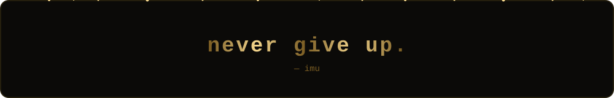

```rust
struct Imu {
    age: u8,
    writes: &'static str,
    runs_on: [&'static str; 2],
}

const ME: Imu = Imu {
    age: 15,
    writes: "Rust",
    runs_on: ["Linux", "Windows 11"],
};
```

### toolbox


<br clear="right">


### building

<a href="https://github.com/cyberworrier8088/DragonIDE"></a>


### the hunt


 


